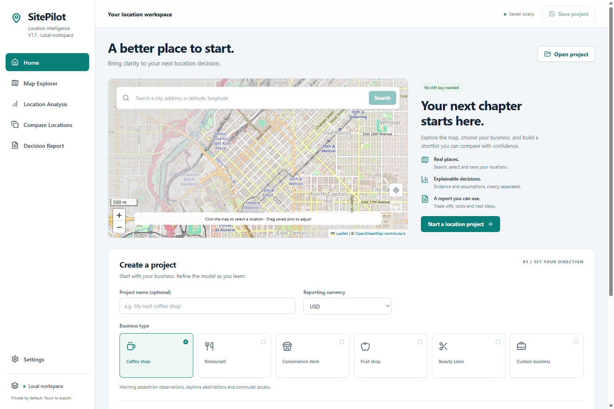
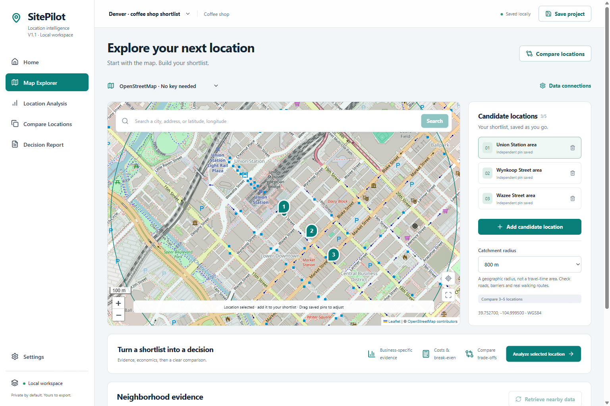
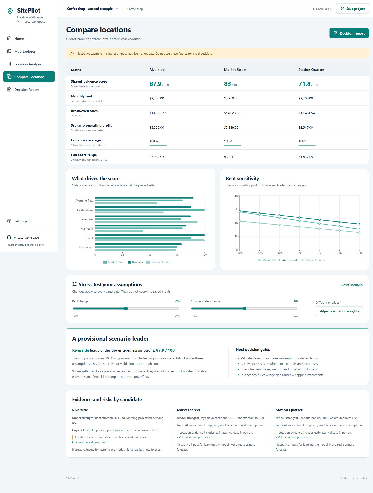
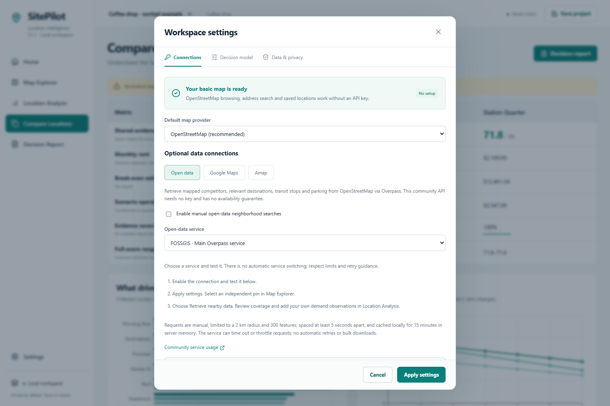

# SitePilot 1.1

A local location-analysis workspace for small business owners. Start on an interactive map without an API key, save up to five candidate locations, investigate business-specific evidence, and compare transparent financial scenarios.

## Launch on Windows — no terminal required

1. Extract **SitePilot-1.1.0-windows-x64.zip** completely into a folder you can keep.
2. If V1.0 is running, right-click its SitePilot notification-area icon and choose **Quit SitePilot**.
3. Double-click **SitePilot.exe** in the extracted folder. Keep the accompanying folders beside it.
4. Your default browser opens at `http://127.0.0.1:47831`.

**Success:** the Home screen immediately shows an interactive OpenStreetMap map. No API key, Node installation or terminal operation is required. Internet access is needed for new tiles and address searches; saved inputs, comparisons and reports work offline.

Windows 10/11 x64 and the standard .NET Framework 4.x desktop runtime are required. The portable launcher is locally built and unsigned. The bundled Node.js 24.16.0 x64 runtime was signature-verified. Follow your organization's normal software approval process; the app does not require disabled security settings.

To quit, use **Quit SitePilot** from the notification-area icon. Closing a browser tab leaves the local service running. Double-clicking the executable again reopens the workspace. Projects belong to the browser profile and local origin; keep using the same browser and port when upgrading.

## Actual application screenshots

These are captures of the running application, not design mockups. Map screenshots contain real OpenStreetMap tiles, with visible attribution. Demonstration pins indicate geographic areas, not available retail premises. Financial screenshots use the prominently labeled synthetic worked example.

### Home: browse immediately



### Map Explorer: saved candidates



### Comparison: evidence and financial scenarios



### Optional connections in Settings



[Location Analysis screenshot](docs/screenshots/analysis.png) · [Full report screenshot](docs/screenshots/report.png) · [Mobile report screenshot](docs/screenshots/report-mobile.png)

Map data and tiles: © [OpenStreetMap contributors](https://www.openstreetmap.org/copyright). The generated design reference in `docs/design-v1.1.png` is a separate concept; it is not used as the application's map.

## Your first comparison

1. **Browse first.** Search an address including its city, or click the map. You can also enter `latitude, longitude` without a geocoding request. Search is explicit, not autocomplete.
2. **Choose your business.** Select coffee shop, restaurant, convenience store, fruit shop, beauty salon or custom business. Enter an optional project name and reporting currency, then **Create project**. A location selected on Home becomes the first candidate.
3. **Build a shortlist.** In Map Explorer, select a point and choose **Add selected location**. Use your own site label. Add 3–5 candidates. Drag saved open-map pins to adjust them, or use **Update pin**. The fit button shows all independent candidates. Location access is requested only when you choose **Use my current location**.
4. **Collect surroundings data when useful.** Open **Data connections → Open data**, enable manual searches, choose a service, and **Test connection**. Apply settings. Select a candidate, then **Retrieve nearby data**. Review returned competitors, relevant destinations, transportation and parking. This public API needs no key, but may be unavailable or incomplete.
5. **Add independent business evidence.** Open **Location Analysis**. Enter the business-specific demand observations, premises checks, survey date and collection method. Choose **User-reported observations** or **User estimates**. SitePilot does not independently verify user entries. Use blanks for unknowns; zero means your method supports a zero observation.
6. **Enter costs.** Supply rent, other fixed costs, contribution margin, average transaction value and trading days. Daily transactions are an optional scenario assumption. Add setup investment, reserve cash and a preferred rent budget if known.
7. **Compare trade-offs.** Compare Locations shows the same shared criteria for all candidates, evidence coverage, uncertainty bounds, criterion charts and rent sensitivity. Test rent and sales changes without overwriting inputs. Open **Calculation and provenance** or **How this is calculated** for formulas and source labels.
8. **Take a report with you.** Decision Report downloads a self-contained HTML briefing or CSV. **Print / Save PDF** uses the browser print dialog. Base assumptions are used; temporary comparison sliders do not alter the report.
9. **Back up your project.** **Save project** downloads a `.sitepilot.json` file. **Open project** restores it. Backups contain independent coordinates, open-data observations and user inputs; credentials and restricted provider caches are excluded.

**Success:** your candidates reappear after reload, and each score can be traced to its inputs, formula, source and assumptions. A missing-data project shows gaps instead of an invented recommendation.

**Try a worked example** demonstrates complete analysis and reporting with explicitly synthetic inputs. It does not imply that those businesses, demand levels or economics exist in the real world.

## Different businesses, different evidence

| Business | Independent demand measure | Relevant mapped / surveyed destinations | Premises requirements |
|---|---|---|---|
| Coffee shop | Morning observations converted to people/hour | Offices, universities, coworking spaces | Transit proximity and step-free entrance |
| Restaurant | Meal-time observations converted to people/hour | Hotels, cinemas, theatres, bars | Extraction permission and legal delivery access |
| Fruit shop | Documented occupied households in the catchment | Markets, bakeries, butchers | Cold storage and produce unloading |
| Convenience store | Observed potential customers during planned hours | Schools, offices, bus stops | Permitted trading hours and replenishment access |
| Beauty salon | Qualified local inquiries normalized to 30 days | Fitness centers, clothing stores, pharmacies | Privacy and required water / drainage |
| Custom business | Qualified local inquiries normalized to 30 days | Independently defined relevant destinations | Permitted business use and essential premises requirements |

All profiles also evaluate demand–competition fit, rent affordability and financial headroom. Defaults are editable planning assumptions, not calibrated industry benchmarks. Settings retains direct weight editing and AHP preference elicitation with a consistency check.

Competition is conditional on independent demand and commercial context. Zero competitors receives no special bonus. Above an editable density threshold, competition reduces the contextual score; below it, fewer competitors do not automatically improve it. Missing demand, missing surroundings, empty API responses or capped results cannot produce a market-fit score.

A provisional scenario leader requires **3–5 sites**, at least **70% shared weighted evidence**, demand and financial scenarios for every site, **positive assumed profit**, no recorded unmet premises requirement for the leading site, and a lead of at least **2 points**. Scores are preferences under assumptions, not success probabilities. Read [the methodology](docs/methodology.md) for formulas, bounds and limitations.

## Optional Google Maps and Amap

Basic browsing and independent location saving never require these services. Provider discovery can incur charges; use your own account, API restrictions, referrer restrictions and quotas.

### Google Maps

1. Enable billing, **Maps JavaScript API** and **Places API (New)** in your Google Cloud project.
2. Create a browser API key limited to those APIs and `http://127.0.0.1:47831/*` (or the actual origin displayed in Settings).
3. Open Settings → Connections → **Google Maps**. Enter the key and, optionally, a map ID. Google's `DEMO_MAP_ID` is used when blank.
4. Choose **Test connection**. It initializes the SDK and performs one place search. Apply settings and select Google Maps in Map Explorer.

**Success:** the Settings test confirms SDK / place-search responses, and a provider map renders. A successful test does not guarantee future availability, billing or quota.

[Google key setup](https://developers.google.com/maps/documentation/javascript/get-api-key) · [Place API reference](https://developers.google.com/maps/documentation/javascript/reference/place)

### Amap

1. Create an Amap **Web JavaScript** application. Copy its Key and matching security code (`jscode`).
2. Configure the allowed local origin / domain in the Amap console.
3. In Settings → Connections → **Amap**, enter both values. Start with the included launcher so the local security proxy is running.
4. Test the connection, apply settings, and select Amap in Map Explorer.

**Success:** the test confirms a map SDK / place-search response. The local proxy adds the signing code to fixed Amap endpoints without putting it in SDK script URLs.

[Amap security guide](https://lbs.amap.com/api/javascript-api-v2/guide/abc/jscode) · [Amap place searches](https://lbs.amap.com/api/javascript-api-v2/guide/services/place-search)

Provider interfaces request English where supported. Source place names, street names and addresses may be local proper names; SitePilot does not invent translations. All application-authored content is English.

### Data rights and persistence

| Data | Local save / reload | Portable export | Display / analysis |
|---|---|---|---|
| Independent GPS / user coordinates | Retained | Retained | Matching coordinate system |
| OSM / Photon location coordinates | Retained with attribution | Retained | Open-map location selection |
| OSM neighborhood observations | Source, time, catchment and counts retained | Retained with ODbL attribution | Context scoring only if fresh, matching and uncapped |
| Google place ID | Retained | Retained | Refresh on Google Maps |
| Google place coordinates | Fixed cache of at most 30 days from retrieval; expired values rejected and removed | Excluded | Google Maps only |
| Google map-click pin without a place ID | Session-only | Excluded | Google Maps only |
| Amap discovery pin and POIs | Session-only | Excluded | Amap only |
| Google / Amap place names, addresses, POI listings | Session-only | Excluded | Provider-map discovery only; no portable derived scores |
| API credentials | Session memory only | Excluded | Browser SDK; Amap code also in local server memory |

You can attach a separate independent pin to a candidate discovered with a restricted provider. Never copy restricted coordinates into the independent-coordinate field. WGS84 and GCJ-02 are not silently converted or relabeled. OpenStreetMap pins remain available when provider credentials are absent.

Google / Amap discovery results do not feed derived scores because their standard content terms restrict such reuse. Use licensed open data or independent evidence for portable analysis. Review [Google service-specific terms](https://cloud.google.com/maps-platform/terms/maps-service-terms) and [Amap terms](https://lbs.amap.com/pages/terms/) for your agreement. OSM data uses [ODbL](https://www.openstreetmap.org/copyright); redistribution of datasets or adapted databases may carry additional attribution and share-alike obligations. This application does not export map tiles.

### Upgrading V1.0 projects

The storage key and origin are retained. V1.0 projects migrate to schema version 2. Costs, notes, independent coordinates, compatible survey fields and allowed Google place IDs remain. New business criteria use new defaults; old generic amenities do not become business-specific evidence automatically. **Coordinates already discarded by V1.0 cannot be recovered**: the app explains when re-pinning or a Google place refresh is needed. A malformed workspace is copied to a recovery storage key before new work overwrites it.

## Network and privacy behavior

- The application server binds only to `127.0.0.1`, rejects foreign Host / Origin / cross-site requests, and serves only the production UI. Amap configuration requires a random session token. External proxy destinations and open-data operations are fixed / allowlisted.
- No SitePilot cloud account, telemetry or analytics is added. Browser storage is not encrypted; people with access to your Windows profile can read project inputs.
- Credentials never enter projects, reports or local storage. Browser keys are necessarily visible to browser developer tools. Reload to clear browser credentials; quit the launcher to clear server memory. **Clear credentials** clears the Settings draft and server signing code; apply it and reload to unload an already loaded SDK.
- Basic tiles come from `tile.openstreetmap.org`. Attribution stays visible; browser caching and referrers are retained. There is no offline tile download, bulk prefetch or service worker tile cache. See the [tile usage policy](https://operations.osmfoundation.org/policies/tiles/).
- Explicit address searches use the [Photon public service](https://github.com/komoot/photon). No autocomplete or background geocoding is used. Queries have a one-second minimum interval and bounded server-memory caching.
- Optional nearby queries use [FOSSGIS Overpass](https://dev.overpass-api.de/overpass-doc/en/preface/commons.html) or the manually selected [Private.coffee service](https://overpass.private.coffee/). Queries have a five-second minimum interval, 15-second execution budget, 22-second network deadline, maximum 2 km radius and 300 returned features. Cache lifetime is 15 minutes. No automatic retries or service rotation is performed.
- Public services have no SLA. Use an appropriately provisioned service for organization-wide / large-scale deployment rather than scaling this local community-service client. Source code exposes the fixed endpoint allowlist for a reviewed deployment change.
- Open observations become ineligible for scoring after 24 hours, after the pin / catchment / business changes, or when the result cap is reached. Empty results remain unknown. Moving an independent pin also clears its survey date so field evidence must be reconfirmed.

## Troubleshooting

| Symptom | Action | Success marker |
|---|---|---|
| Map tiles unavailable | Check internet / firewall, reopen Map Explorer; use independent coordinates and saved inputs meanwhile | Real tiles load and attribution is visible |
| Address search has no results | Include city / country, select the map directly, or enter independent `latitude, longitude` | A selected point can be saved |
| Nearby request times out | Wait, reduce radius, or explicitly choose and test another community service; use field evidence meanwhile | A dated observation or clear error appears; no invented counts |
| Missing Google / Amap key | Use OpenStreetMap or configure the optional service in Settings | Basic map works without credentials |
| Key rejected | Check key type, enabled APIs, billing, restrictions, security code and quota | Settings connection test succeeds |
| Key changed after SDK loaded | Apply settings, reload, and enter the new key | The new SDK session tests successfully |
| Score is missing | Review the formula, evidence date / method / radius, freshness and business-specific inputs | Coverage increases only when usable evidence is supplied |
| No recommendation | Add 3–5 candidates and required shared evidence; resolve unmet requirements and loss scenarios | A justified provisional leader or an explicit tie / gap explanation |
| Project absent after upgrade | Use the same browser profile and origin, or import your backup | Independent pins and inputs reappear |
| Port 47831 is occupied | Quit the previous SitePilot tray session; do not launch two versions at once | V1.1 opens in the browser |
| Local saving fails | Download a project backup; check browser storage restrictions / capacity | Saved locally indicator returns |

## Full source and developer builds

The portable package includes the full application source, tests, launcher source and build scripts. A smaller **SitePilot-1.1.0-source.zip** is also provided. It omits `node_modules`, generated build output, the runtime executable, caches and test artifacts.

Developer prerequisites: Node.js 22.12+ (tested with 24.16.0), npm, Windows x64 for the launcher, .NET Framework C# compiler, and Chrome for browser tests. End users do not need these tools.

1. Open a terminal in the source folder and install locked dependencies:

   ```powershell
   npm ci
   ```

2. Build and run the production application:

   ```powershell
   npm run build
   npm start
   ```

   **Success:** V1.1 opens at `http://127.0.0.1:47831`; `/api/health` reports version `1.1.0`.

3. Run the verification suite:

   ```powershell
   npm test
   npm run test:e2e
   ```

   **Success:** all financial, storage, provider-isolation and browser workflow checks pass. Automated map interaction tests mock tiles; SDK tests use clearly synthetic provider fixtures and incur no API charges.

4. Build a portable Windows release:

   ```powershell
   npm run package
   ```

   **Success:** the versioned Windows ZIP, source ZIP and SHA-256 files appear in `releases`. The Node packaging script compiles the GUI launcher, includes Node and notices, and refuses to overwrite an existing release. Use a clean source extraction or a new version for a new release.

The npm packaging command does not require changing PowerShell execution policy. A PowerShell build helper is also included for environments that permit script files.

For UI development, run `node server.mjs` and `npm run dev` in separate terminals. Vite proxies the local data routes to the production backend. Add the development origin to provider key restrictions if testing optional SDKs.

Project layout:

```text
src/                  React UI, model, profiles, storage and provider adapters
server.mjs            Loopback service and Amap security proxy
open-services.mjs     Bounded Photon / Overpass integration
launcher/SitePilot.cs  Windows GUI launcher and tray lifecycle
scripts/              Build, license collection and documentation capture
public/               Application icon assets
runtime/              Bundled Node executable and license (portable package)
tests/                Core / server tests and Playwright browser workflows
docs/                 Screenshots, methodology, design reference and verification
```

[Verification and known limits](docs/verification.md) · [Methodology](docs/methodology.md) · [Change log](CHANGELOG.md)
